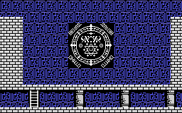
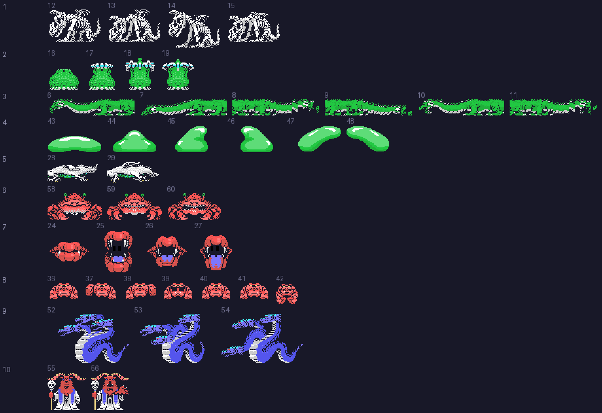

# The bosses

*The boss room of world 1 before the boss appears: the seal is the 8 × 8
character frame at 0x9BE2. Its left half is the patterns at 0xB760 (30
characters from 0x5A, entry p10:6121) and the right half, the same
characters flipped (copies at p10:6128). p00:56FA loads it while the boss has
not come out.*

The boss does not appear on its own: in its room you have to type its name
(p02:9B18 compares the last letters typed). Then smoke comes out and, after
it, the boss, with the room's background in black.

*The ten bosses in full, with the number of their world. They are not
sprites: they are character mosaics (61 in the table at 0x9E0A in bank 14)
swapped to move them. p00:5856 loads their graphics; world 3's goes in steps,
one piece per frame.*

Which mosaics each boss uses was measured in game, frame by frame, over 6000
frames; the 18 seen whole match openMSX.
