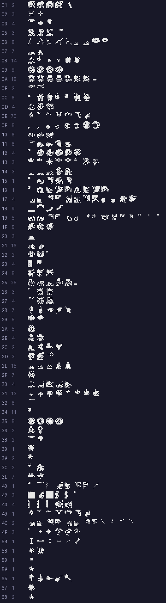

# The enemies

*The sprite sets each room loads (base 0x790D and tables 0x9737 and 0x7C72),
in white: each figure sets its own colour when it appears.*

Patterns go by room, not by enemy: each room loads its set and its figures
share it. Those of all 321 rooms match openMSX.
