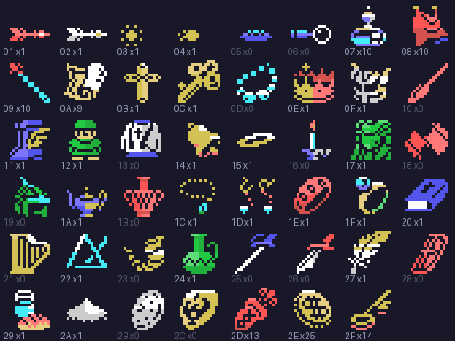

# The items and the shops

## The items

*The 47 item types (1 to 0x2F), each with its number and how many there are
in the rooms. Types 7 to 0x2C have their own picture (0x6E34 and 0x6E80 in
bank 10); the last three are arrows, coins and keys.*

The game never names them: it only draws them. That is why they go by number
here. What each one does comes from who reads its flag (0xE06F plus the
type); some of them:

- **0x07:** the world boss's life starts at half.
- **0x08:** the boss takes off half when it touches you.
- **0x0B:** without it GALIOUS cannot be hurt.
- **0x11:** you walk faster.
- **0x19:** the figures take off half.
- **0x1B:** every enemy gives double experience.
- **0x20:** with CTRL the figures and the boss stop, up to 16 times.
- **0x25:** every hit takes off double.

The rest, with their addresses, are in `tools/objetos.py`.

## The shops

There are 13 shop entries (0x9255 in bank 2), of up to three items each, with
the price in coins:

| What is sold | Price |
|---|---|
| 100 arrows (0x2D) | 20 |
| a key (0x2F) | 5 |
| 0x05, 0x06 | 30, 20 |
| 0x0D, 0x23 | 25 |
| 0x10, 0x18, 0x21, 0x28 | 30 |
| 0x2B | 40 |
| 0x19, 0x2C | 50 |

The feather shop (0x10, entry 12), in room 18 of world 5, is checked in
openMSX.
