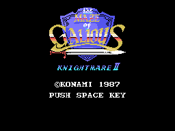
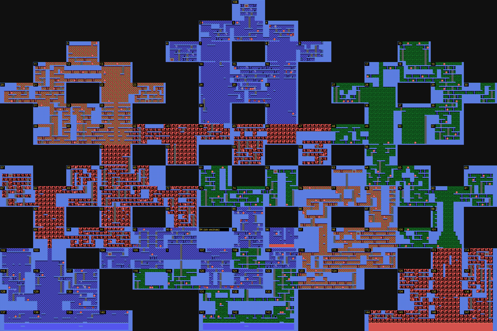

# The castle and the worlds

Popolon and Aphrodite explore **the castle and ten worlds: 321 rooms**. The
castle has 147; the worlds have 15 to 27, and the tenth, GALIOUS's, has 6. On
this site map 1 is the castle and maps 2 to 11 are worlds 1 to 10.

Every picture on this page is **drawn from the bytes of the ROM** with the
tools in `tools/`, which follow the cartridge's own steps, and checked
against openMSX dumps (`C-BIOS_MSX1_JP`). Each caption says which table it
comes from.

## The title screen

*The logo: 6 rows of 21 characters from 0x40 (p01:6957), with the patterns
at 0xBCEF in bank 9. It appears from top to bottom, one line of every row
every two frames (p01:6985), over the blue of register 7 (0xE4).*

*The sign at 0x933F (14 × 12 characters), the letters of the list at 0x7D51
and four sprites from 0x93E7. A sparkle runs down the sword and goes out
(p01:6267).*

Both match openMSX in all 16 KB of VRAM (`titulo.py coteja`).

## The castle

*The castle's 147 rooms, each with its number, laid out by their neighbours
(table 0xA9EF in bank 9). Each room is 8 × 5 blocks of 4 × 4 characters.*

The order of the neighbours (up, down, left, right) is checked in openMSX:
leaving by the left and right edges leads to the room the table says, and the
four rooms the game loads at 0xE648 are the table's; up and down are used by
p03:A7F8. Rooms are numbered in reading order except those at the entrance.
Room 94 has no neighbours: it goes in the only gap left between 93 and 95,
and how to reach it is in [Open questions](CURIOSITIES.html).

On top of the floor plan the game places ladders, the world doors and the
way-back doors, items and pink orbs. All 321 rooms, with all of that, match
openMSX character for character.

## The ten worlds

| World | Rooms | The boss's name |
|---|---|---|
| [1](imagenes/mapa_2.png) | 15 | YOMAR |
| [2](imagenes/mapa_3.png) | 15 | ELOHIM |
| [3](imagenes/mapa_4.png) | 16 | HAHAKLA |
| [4](imagenes/mapa_5.png) | 17 | BARECHET |
| [5](imagenes/mapa_6.png) | 18 | HEOTYMEO |
| [6](imagenes/mapa_7.png) | 19 | LEPHA |
| [7](imagenes/mapa_8.png) | 20 | NAWABRA |
| [8](imagenes/mapa_9.png) | 21 | ASCHER |
| [9](imagenes/mapa_10.png) | 27 | XYWOLEH |
| [10](imagenes/mapa_11.png) | 6 | HAMALECH |

*Each number links to its map. The names come from the table at 0x9B4F in
bank 2, three bytes per map: where the text is and how many letters it
has.*

The black rooms on the maps are the hint and shop rooms: the game does not
build them like the others (see [Findings](CURIOSITIES.html)).
