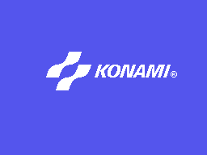
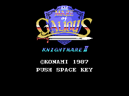
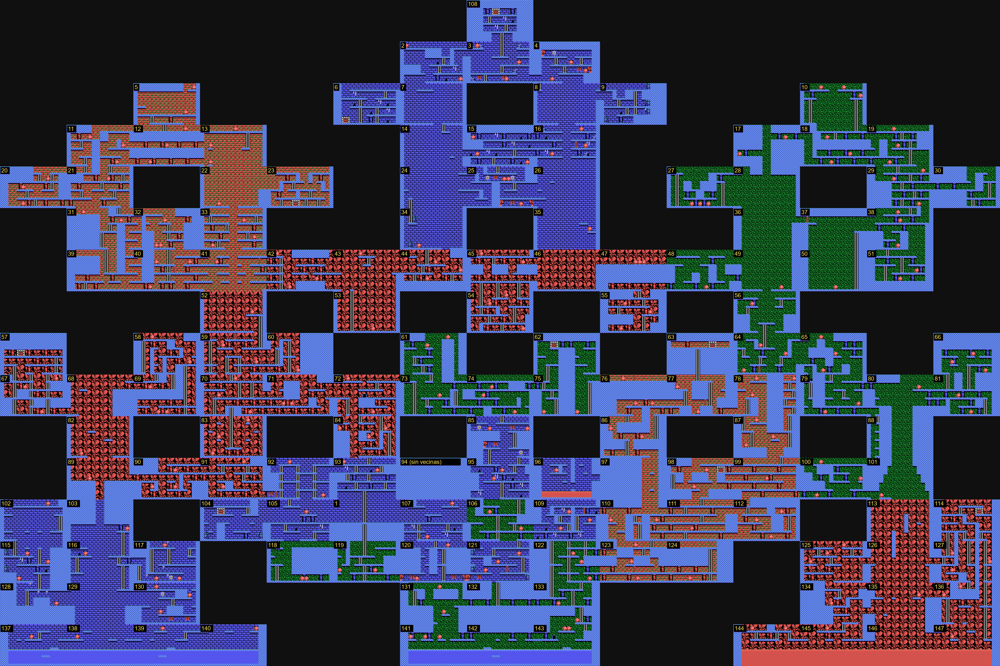
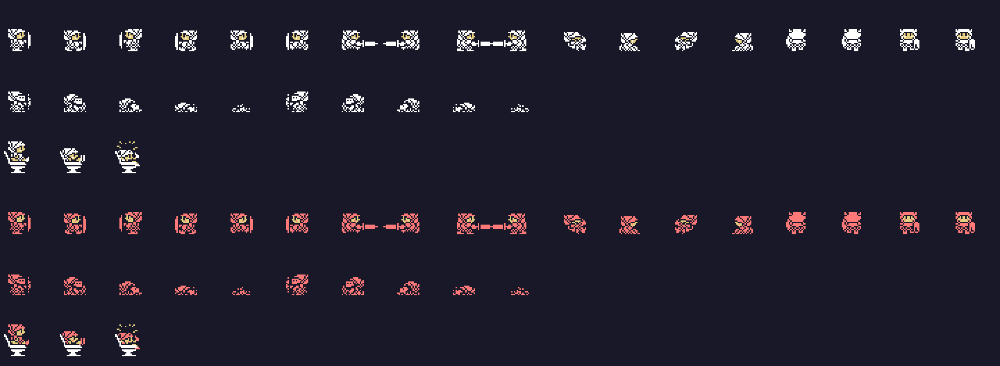
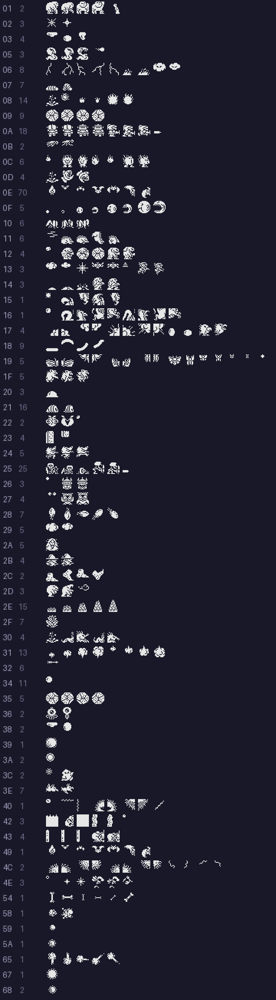
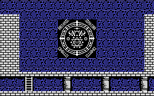
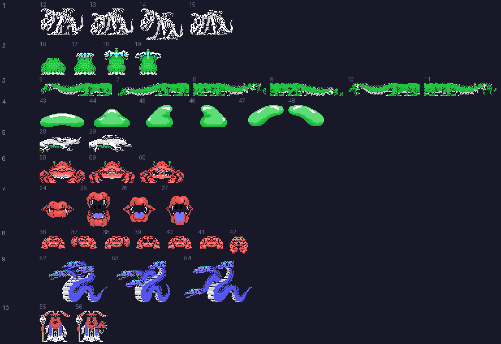
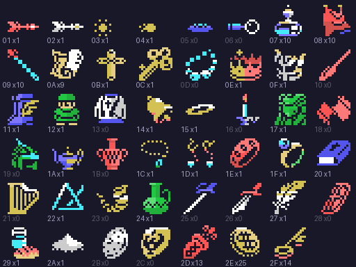

# El juego

Popolon y Afrodita recorren **el castillo y diez mundos: 321 salas**. El
castillo tiene 147; los mundos, de 15 a 27, y el décimo, el de GALIOUS, 6. En
esta web el mapa 1 es el castillo y los mapas 2 a 11 son los mundos 1 a 10.

Todas las imágenes de esta página están **dibujadas desde los bytes de la
ROM** con las herramientas de `tools/`, que siguen los pasos del propio
cartucho, y cotejadas contra volcados de openMSX (`C-BIOS_MSX1_JP`). Debajo
de cada una se dice de qué tabla sale.

## La pantalla de título

*El logotipo: 6 filas de 21 caracteres desde el 0x40 (p01:6957), con los
dibujos de 0xBCEF del banco 9. Sale de arriba abajo, una línea de cada fila
cada dos cuadros (p01:6985), sobre el azul del registro 7 (0xE4).*

*El rótulo de 0x933F (14 × 12 caracteres), las letras de la lista 0x7D51 y
cuatro sprites de 0x93E7. Un destello baja por la espada y se apaga
(p01:6267).*

Los dos coinciden con openMSX en los 16 KB de la VRAM (`titulo.py coteja`).

## El castillo

*Las 147 salas del castillo, cada una con su número, colocadas por sus
vecinas (tabla 0xA9EF del banco 9). Cada sala son 8 × 5 bloques de 4 × 4
caracteres.*

El orden de las vecinas (arriba, abajo, izquierda, derecha) está comprobado
en openMSX: saliendo por la izquierda y por la derecha se llega a la sala que
dice la tabla, y las cuatro que el juego carga en 0xE648 son las de la tabla;
arriba y abajo los usa p03:A7F8. Las salas se numeran en orden de lectura salvo
las de la entrada. La 94 no tiene vecinas: va en el único hueco que queda
entre la 93 y la 95, y cómo se llega a ella está en
[Preguntas abiertas](PREGUNTAS-ABIERTAS.md).

Encima de la planta, el juego monta escaleras, puertas de los mundos y de
vuelta, objetos y bolas rosas. Las 321 salas, con todo eso, coinciden con
openMSX carácter a carácter.

## Los diez mundos

| Mundo | Salas | El nombre del jefe |
|---|---|---|
| [1](../imagenes/mapa_2.png) | 15 | YOMAR |
| [2](../imagenes/mapa_3.png) | 15 | ELOHIM |
| [3](../imagenes/mapa_4.png) | 16 | HAHAKLA |
| [4](../imagenes/mapa_5.png) | 17 | BARECHET |
| [5](../imagenes/mapa_6.png) | 18 | HEOTYMEO |
| [6](../imagenes/mapa_7.png) | 19 | LEPHA |
| [7](../imagenes/mapa_8.png) | 20 | NAWABRA |
| [8](../imagenes/mapa_9.png) | 21 | ASCHER |
| [9](../imagenes/mapa_10.png) | 27 | XYWOLEH |
| [10](../imagenes/mapa_11.png) | 6 | HAMALECH |

*Cada número lleva a su mapa. Los nombres salen de la tabla 0x9B4F del banco
2, tres bytes por mapa: dónde está el texto y cuántas letras tiene.*

Las salas en negro de los mapas son las de las pistas y las tiendas: el juego
no las monta como las demás (ver [Hallazgos](HALLAZGOS.md)).

## Popolon y Afrodita

*Las 32 poses del jugador (tabla 0x7529 del banco 1), arriba Popolon y abajo
Afrodita. De la 18 a la 27 se hunde (p00:5832). Cotejadas con openMSX en 2748
situaciones de partida.*

Los dos usan los mismos dibujos; Afrodita lleva el color 9 donde Popolon lleva
el 15.

## Los enemigos

*Los juegos de sprites que carga cada sala (base 0x790D y tablas 0x9737 y
0x7C72), en blanco: el color lo pone cada figura al salir.*

Los dibujos van por sala y no por enemigo: cada sala carga su juego y sus
figuras lo comparten. Los de las 321 salas coinciden con openMSX.

## Los jefes

*La sala del jefe del mundo 1 antes de que salga: el sello es el recuadro de 8
× 8 caracteres de 0x9BE2. Su mitad izquierda son los dibujos de 0xB760 (30
caracteres desde el 0x5A, ficha p10:6121) y la derecha, los mismos caracteres
dados la vuelta (copias de p10:6128). Lo carga p00:56FA mientras el jefe no ha
salido.*

El jefe no aparece solo: en su sala hay que teclear su nombre (p02:9B18
compara las últimas letras tecleadas). Entonces sale un humo y después el
jefe, con el fondo de la sala en negro.

*Los diez jefes enteros, con el número de su mundo. No son sprites: son
mosaicos de caracteres (61 en la tabla 0x9E0A del banco 14) que se cambian
para moverlos. Sus gráficos los carga p00:5856; el del mundo 3, por pasos, un
trozo cada cuadro.*

Qué mosaicos usa cada jefe se midió en partida, cuadro a cuadro, durante 6000
cuadros; los 18 que se ven enteros coinciden con openMSX.

## Los objetos

*Los 47 tipos de objeto (1 a 0x2F), cada uno con su número y cuántos hay en
las salas. Los de 7 a 0x2C tienen dibujo propio (0x6E34 y 0x6E80 del banco
10); los últimos tres son flechas, monedas y llaves.*

El juego no los nombra en ningún sitio: solo los dibuja. Por eso aquí van por
número. Lo que hace cada uno sale de quién mira su marca (0xE06F más el tipo);
algunos:

- **0x07:** la vida del jefe del mundo empieza a la mitad.
- **0x08:** el jefe quita la mitad al tocarte.
- **0x0B:** sin él no se puede herir a GALIOUS.
- **0x11:** se anda más deprisa.
- **0x19:** las figuras quitan la mitad.
- **0x1B:** cada enemigo da el doble de experiencia.
- **0x20:** con CTRL se paran las figuras y el jefe, hasta 16 veces.
- **0x25:** cada golpe quita el doble.

Los demás, con su dirección, en `tools/objetos.py`.

## Las tiendas

Hay 13 fichas de tienda (0x9255 del banco 2), de hasta tres artículos cada
una, con el precio en monedas:

| Lo que se vende | Precio |
|---|---|
| 100 flechas (0x2D) | 20 |
| una llave (0x2F) | 5 |
| 0x05, 0x06 | 30, 20 |
| 0x0D, 0x23 | 25 |
| 0x10, 0x18, 0x21, 0x28 | 30 |
| 0x2B | 40 |
| 0x19, 0x2C | 50 |

La tienda de la pluma (0x10, ficha 12), en la sala 18 del mundo 5, está
comprobada en openMSX.
