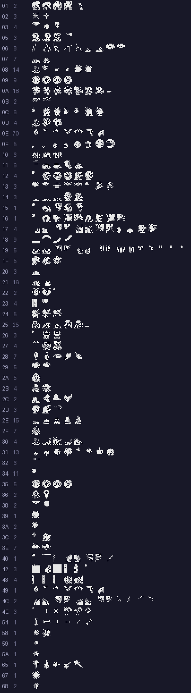

# Los enemigos

*Los juegos de sprites que carga cada sala (base 0x790D y tablas 0x9737 y
0x7C72), en blanco: el color lo pone cada figura al salir.*

Los dibujos van por sala y no por enemigo: cada sala carga su juego y sus
figuras lo comparten. Los de las 321 salas coinciden con openMSX.
