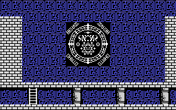
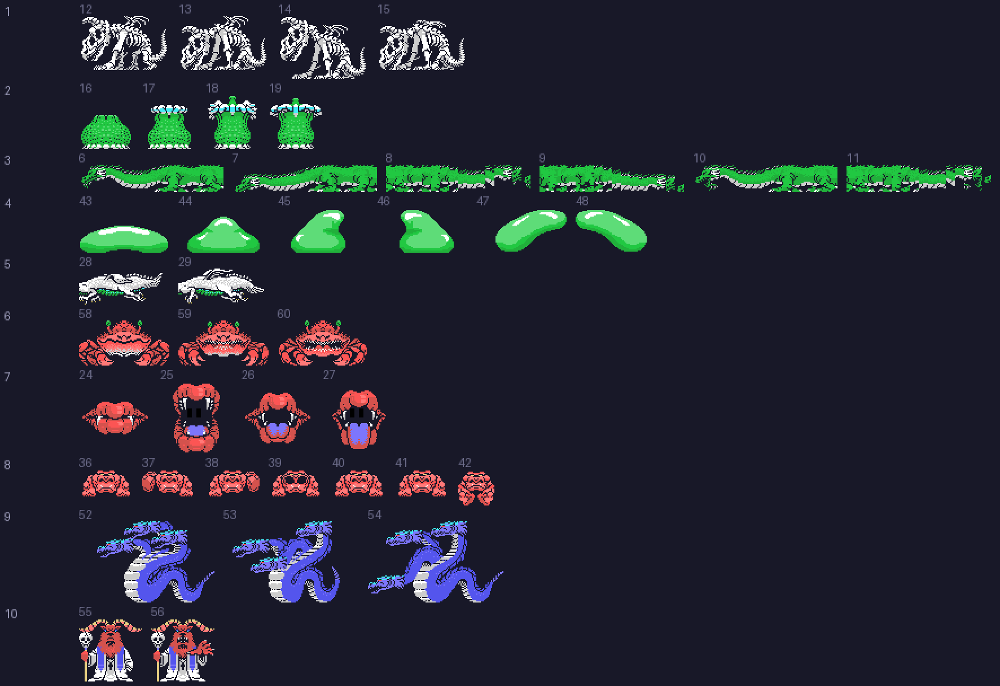

# Los jefes

*La sala del jefe del mundo 1 antes de que salga: el sello es el recuadro de 8
× 8 caracteres de 0x9BE2. Su mitad izquierda son los dibujos de 0xB760 (30
caracteres desde el 0x5A, ficha p10:6121) y la derecha, los mismos caracteres
dados la vuelta (copias de p10:6128). Lo carga p00:56FA mientras el jefe no ha
salido.*

El jefe no aparece solo: en su sala hay que teclear su nombre (p02:9B18
compara las últimas letras tecleadas). Entonces sale un humo y después el
jefe, con el fondo de la sala en negro.

*Los diez jefes enteros, con el número de su mundo. No son sprites: son
mosaicos de caracteres (61 en la tabla 0x9E0A del banco 14) que se cambian
para moverlos. Sus gráficos los carga p00:5856; el del mundo 3, por pasos, un
trozo cada cuadro.*

Qué mosaicos usa cada jefe se midió en partida, cuadro a cuadro, durante 6000
cuadros; los 18 que se ven enteros coinciden con openMSX.
