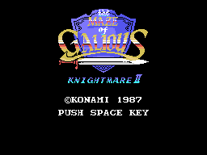
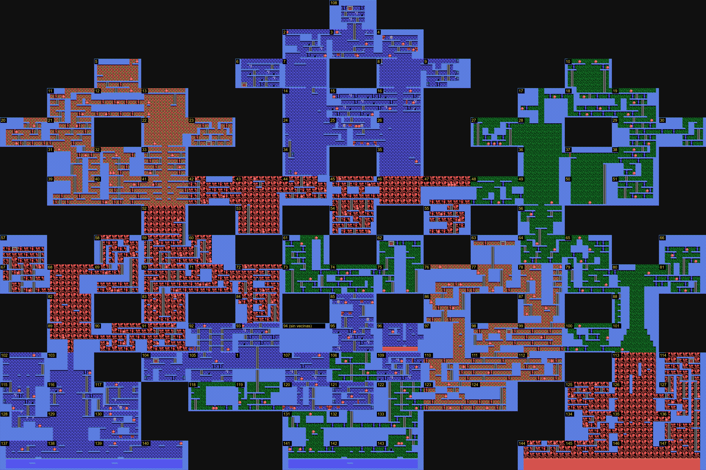

# El castillo y los mundos

Popolon y Afrodita recorren **el castillo y diez mundos: 321 salas**. El
castillo tiene 147; los mundos, de 15 a 27, y el décimo, el de GALIOUS, 6. En
esta web el mapa 1 es el castillo y los mapas 2 a 11 son los mundos 1 a 10.

Todas las imágenes de esta página están **dibujadas desde los bytes de la
ROM** con las herramientas de `tools/`, que siguen los pasos del propio
cartucho, y cotejadas contra volcados de openMSX (`C-BIOS_MSX1_JP`). Debajo
de cada una se dice de qué tabla sale.

## La pantalla de título

*El logotipo: 6 filas de 21 caracteres desde el 0x40 (p01:6957), con los
dibujos de 0xBCEF del banco 9. Sale de arriba abajo, una línea de cada fila
cada dos cuadros (p01:6985), sobre el azul del registro 7 (0xE4).*

*El rótulo de 0x933F (14 × 12 caracteres), las letras de la lista 0x7D51 y
cuatro sprites de 0x93E7. Un destello baja por la espada y se apaga
(p01:6267).*

Los dos coinciden con openMSX en los 16 KB de la VRAM (`titulo.py coteja`).

## El castillo

*Las 147 salas del castillo, cada una con su número, colocadas por sus
vecinas (tabla 0xA9EF del banco 9). Cada sala son 8 × 5 bloques de 4 × 4
caracteres.*

El orden de las vecinas (arriba, abajo, izquierda, derecha) está comprobado
en openMSX: saliendo por la izquierda y por la derecha se llega a la sala que
dice la tabla, y las cuatro que el juego carga en 0xE648 son las de la tabla;
arriba y abajo los usa p03:A7F8. Las salas se numeran en orden de lectura salvo
las de la entrada. La 94 no tiene vecinas: va en el único hueco que queda
entre la 93 y la 95, y cómo se llega a ella está en
[Preguntas abiertas](CURIOSIDADES.html).

Encima de la planta, el juego monta escaleras, puertas de los mundos y de
vuelta, objetos y bolas rosas. Las 321 salas, con todo eso, coinciden con
openMSX carácter a carácter.

## Los diez mundos

| Mundo | Salas | El nombre del jefe |
|---|---|---|
| [1](../imagenes/mapa_2.png) | 15 | YOMAR |
| [2](../imagenes/mapa_3.png) | 15 | ELOHIM |
| [3](../imagenes/mapa_4.png) | 16 | HAHAKLA |
| [4](../imagenes/mapa_5.png) | 17 | BARECHET |
| [5](../imagenes/mapa_6.png) | 18 | HEOTYMEO |
| [6](../imagenes/mapa_7.png) | 19 | LEPHA |
| [7](../imagenes/mapa_8.png) | 20 | NAWABRA |
| [8](../imagenes/mapa_9.png) | 21 | ASCHER |
| [9](../imagenes/mapa_10.png) | 27 | XYWOLEH |
| [10](../imagenes/mapa_11.png) | 6 | HAMALECH |

*Cada número lleva a su mapa. Los nombres salen de la tabla 0x9B4F del banco
2, tres bytes por mapa: dónde está el texto y cuántas letras tiene.*

Las salas en negro de los mapas son las de las pistas y las tiendas: el juego
no las monta como las demás (ver [Hallazgos](CURIOSIDADES.html)).
