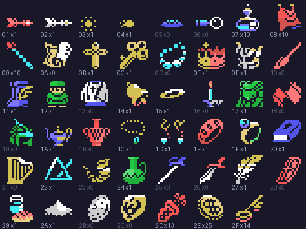

# Los objetos y las tiendas

## Los objetos

*Los 47 tipos de objeto (1 a 0x2F), cada uno con su número y cuántos hay en
las salas. Los de 7 a 0x2C tienen dibujo propio (0x6E34 y 0x6E80 del banco
10); los últimos tres son flechas, monedas y llaves.*

El juego no los nombra en ningún sitio: solo los dibuja. Por eso aquí van por
número. Lo que hace cada uno sale de quién mira su marca (0xE06F más el tipo);
algunos:

- **0x07:** la vida del jefe del mundo empieza a la mitad.
- **0x08:** el jefe quita la mitad al tocarte.
- **0x0B:** sin él no se puede herir a GALIOUS.
- **0x11:** se anda más deprisa.
- **0x19:** las figuras quitan la mitad.
- **0x1B:** cada enemigo da el doble de experiencia.
- **0x20:** con CTRL se paran las figuras y el jefe, hasta 16 veces.
- **0x25:** cada golpe quita el doble.

Los demás, con su dirección, en `tools/objetos.py`.

## Las tiendas

Hay 13 fichas de tienda (0x9255 del banco 2), de hasta tres artículos cada
una, con el precio en monedas:

| Lo que se vende | Precio |
|---|---|
| 100 flechas (0x2D) | 20 |
| una llave (0x2F) | 5 |
| 0x05, 0x06 | 30, 20 |
| 0x0D, 0x23 | 25 |
| 0x10, 0x18, 0x21, 0x28 | 30 |
| 0x2B | 40 |
| 0x19, 0x2C | 50 |

La tienda de la pluma (0x10, ficha 12), en la sala 18 del mundo 5, está
comprobada en openMSX.
