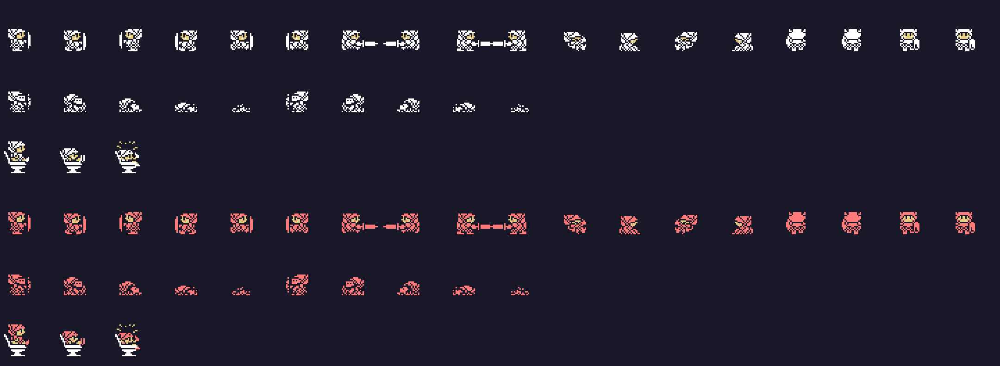

# Popolon y Afrodita

*Las 32 poses del jugador (tabla 0x7529 del banco 1), arriba Popolon y abajo
Afrodita. De la 18 a la 27 se hunde (p00:5832). Cotejadas con openMSX en 2748
situaciones de partida.*

Los dos usan los mismos dibujos; Afrodita lleva el color 9 donde Popolon lleva
el 15.
